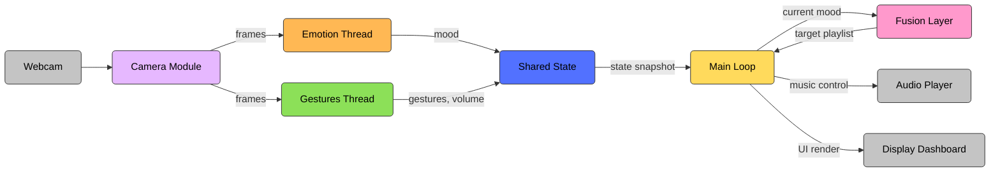

# MoodSync Architecture

Here is the system architecture specific to the MoodSync project, reflecting how the components interact in your codebase:

### Flow Breakdown:
1. **Camera Module (`camera.py`)**: Runs continuously to grab frames from the webcam and avoids multiple processes fighting for access.
2. **Input Threads (`inputs/emotion.py` & `inputs/gestures.py`)**: Analyze frames in the background using MediaPipe to extract mood and gestures (e.g. swipes, volume levels).
3. **Shared State (`state.py`)**: Acts as a thread-safe data store. The input threads write predictions here, preventing blocking.
4. **Main Loop (`main.py`)**: Reads a snapshot of the shared state every frame.
5. **Fusion Layer (`fusion.py`)**: A logic mapper that tells the Main Loop which playlist corresponds to the current mood.
6. **Output (Pygame)**: The Main Loop handles UI rendering (video, dashboard) and executes audio commands (play, pause, switch playlists).
